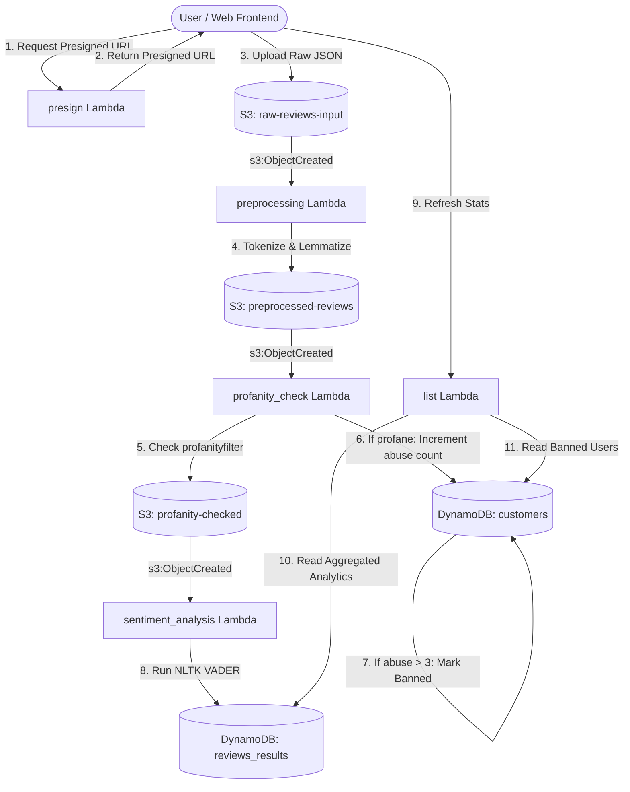

# Serverless Customer Review Analysis AI Platform

This is an event-driven serverless application designed to analyze customer reviews in real-time. The application runs on local AWS emulator **MiniStack** (or LocalStack) and uses a chain of **AWS Lambda** functions triggered by **Amazon S3** events, storing persistent states and results in **Amazon DynamoDB**.

For a concise runbook, see [instructions.pdf](instructions.pdf).

---

## Architecture Flow

The pipeline executes sequentially using S3 bucket events to trigger lambdas, decoupling the processing stages:



### Pipelines & Services
1. **S3 Buckets**:
   - `ministack-reviews-input`: Bucket where raw reviews are uploaded.
   - `ministack-reviews-preprocessed`: Stores preprocessed reviews (tokenized, lowercase, stop words removed, lemmatized).
   - `ministack-reviews-profanity-checked`: Stores reviews with a boolean flag indicating if profanity was detected.
2. **DynamoDB Tables**:
   - `customers`: Tracks customer statistics (Reviewer ID, impolite reviews count, and banned status).
   - `reviews_results`: Stores final analyzed reviews (reviewerID, original text, preprocessed text, profanity status, rating, and sentiment score).
3. **Lambda Functions**:
   - **`presign`**: Generates S3 pre-signed POST URLs for the frontend to upload reviews directly.
   - **`preprocessing`**: Cleans review text and summaries using Python's **NLTK** package (tokenization, stop-word removal, and WordNet Lemmatization).
   - **`profanity_check`**: Checks for profanity using **`profanityfilter`**. Automatically updates DynamoDB customer logs and flags repeat offenders (marked `is_banned = true` if > 3 profane reviews).
   - **`sentiment_analysis`**: Analyzes the polarity of reviews using NLTK VADER and categorizes them into `positive`, `neutral`, or `negative`. Saves the final results in DynamoDB.
   - **`list`**: Scans the DynamoDB tables to return aggregated insights, counts, and banned user arrays to the frontend.

---

## Getting Started

### Run Locally

#### 1. Setup the Virtual Environment
Navigate to the `src` directory and install the dependencies:
```bash
cd src
python3 -m venv .venv
source .venv/bin/activate
pip install -r requirements.txt
```

#### 2. Start the MiniStack Emulator
Start the AWS emulator on port `4566` in your terminal:
```bash
ministack
```
*(Keep this window open and running).*

#### 3. Deploy the Infrastructure
In a **new terminal tab** (with the `.venv` activated), deploy the S3 buckets, DynamoDB tables, parameter values, and Lambda functions:
```bash
cd src
source .venv/bin/activate
bash ./run.sh
```

---

### Run on the LBD Cluster

On the LBD cluster, you do not need to set up a virtual environment or run `pip install` globally, as `ministack` and `awscli` are already pre-installed.

#### 1. Start the MiniStack Emulator
In your JupyterHub shell, start the emulator:
```bash
ministack
```
*(Keep this window open and running).*

#### 2. Deploy the Infrastructure
In a **new terminal tab**, navigate to the directory and run the deployment script:
```bash
cd src
bash ./run.sh
```

#### 3. Access the Web Frontend
Open the following proxy URL in your browser:
```text
https://lbd.tuwien.ac.at/user/$USER/proxy/4566/webapp/index.html
```
*(Make sure to replace `$USER` with your actual LBD cluster username).*

---

### 4. Running Automated Integration Tests
Verify the entire function chain, profanity logic, and user banning behavior by running the pytest suite (activate `.venv` first if running locally):
```bash
pytest tests/
```

### 5. Access the Web Frontend
Open your browser and navigate to:
[http://localhost:4566/webapp/index.html](http://localhost:4566/webapp/index.html)

Here you can submit reviews manually and see real-time changes inside the **Live Insights Dashboard**!

---

## Repository Structure

- `src/`
  - `run.sh` — Deployment script for buckets, tables, and lambdas.
  - `requirements.txt` — Project-wide development and testing dependencies.
  - `lambdas/` — Directories containing lambda functions:
    - `presign/`
    - `list/`
    - `preprocessing/`
    - `profanity_check/`
    - `sentiment_analysis/`
  - `website/` — HTML/CSS/JS files for the premium glassmorphism frontend.
  - `tests/` — Automated pytest script.
- `assignment_3_tutorial/` — Original tutorial references.
- `docs/` — Class slides and specifications.
- `instructions.pdf` — Short execution guide for running the application.
