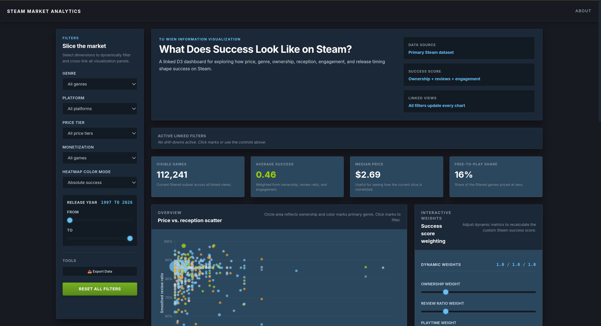
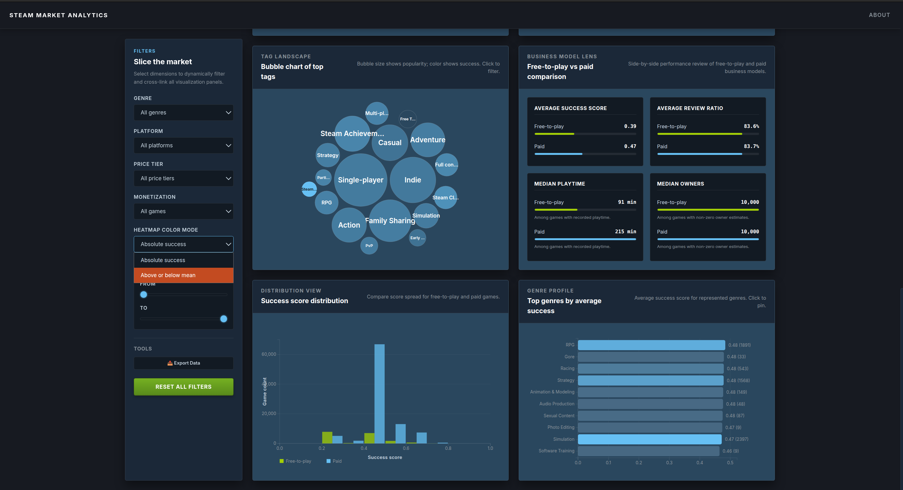
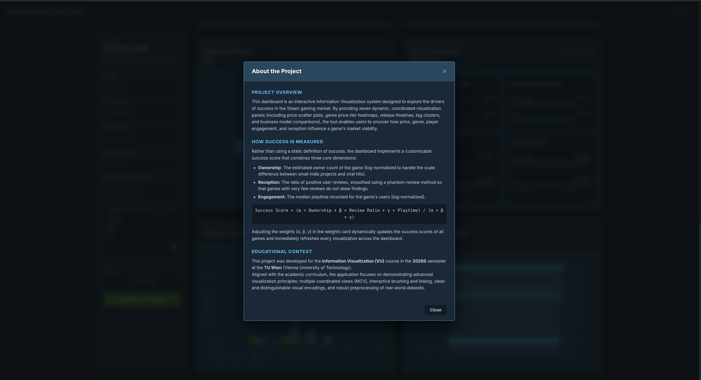

# Slide 1. Question and Hypothesis

**Research question**

- Which combinations of price, genre, ownership, review reception, engagement, and release timing are associated with success on Steam?
- We treated success as a multi-factor outcome instead of a single metric.

**Hypothesis before analysis**

- Success on Steam is not explained by review score alone.
- Mid-priced paid games and established genre segments should outperform free-to-play titles once ownership, reviews, and engagement are considered together.

**Success score used in the dashboard**

```text
Success Score =
  (alpha * normalized log ownership
   + beta * review ratio
   + gamma * normalized log median playtime)
  / (alpha + beta + gamma)
```

**Speaker cue**

- Start with the idea that the project is about market structure, not about ranking a few blockbuster games.



---

# Slide 2. Data and Preprocessing

**Data used**

- Primary source: Kaggle Steam games dataset downloaded with KaggleHub.
- Final dashboard dataset: 112,241 games.
- Time span in the processed data: 1997 to 2026.

**Preprocessing steps that were necessary**

- Repaired the malformed raw header issue where `DiscountDLC count` had to be split into `Discount` and `DLC count`.
- Kept only relevant analysis columns and removed rows with missing required values.
- Parsed release dates, derived release year, and normalized schema aliases across different column names.
- Converted owner ranges such as `20,000 - 50,000` to numeric midpoints.
- Normalized prices, derived price tiers, and flagged free-to-play titles.
- Smoothed review ratios with phantom reviews so very low-review games were less misleading.
- Log-normalized ownership and playtime before scoring.
- Filtered obvious outliers such as extreme prices and invalid age or discount values.

**Why this matters**

- The analysis depends on turning messy marketplace data into comparable numeric features.

---

# Slide 3. Visualization and Interaction Design

**Why these views were chosen**

- Scatter plot: shows price versus review reception while also exposing ownership and genre.
- Heatmap: aggregates genre by price tier to reveal which segments overperform.
- Time panel: connects success, pricing, and release volume over time.
- Tag bubble chart: shows which tags are most prevalent and whether they align with stronger success.
- Free-to-play versus paid cards, score distribution, and genre ranking make headline comparisons easy to read.

**Interaction design**

- Global filters for genre, platform, price tier, monetization, year range, and heatmap mode.
- Direct chart-to-chart linking: clicking points, heatmap cells, years, bars, or bubbles updates the full dashboard.
- Active linked filters are shown as removable chips, so the drill-down state stays visible during a live demo.
- The heatmap supports both sequential absolute color and diverging above/below-average color, directly reflecting teacher feedback.

**Design decision from feedback**

- We committed to a bubble chart for tags instead of leaving the proposal ambiguous between a network and a bubble chart.



---

# Slide 4. How the Prototype Was Implemented

**Implementation stack**

- Python pipeline for downloading, repairing, cleaning, and engineering features.
- Flask backend serving the dashboard shell and `GET /api/dashboard-data`.
- Frontend built with custom D3, HTML, and CSS rather than an out-of-the-box dashboard builder.

**What is custom in the implementation**

- The success score is recalculated in the client when the user changes the three weights.
- All seven views share one coordinated filter state.
- The scatter plot samples large point sets for readability and performance.
- Users can export the currently filtered subset as CSV and reset the entire exploration state quickly.

**Why this supports grading**

- The project combines non-trivial data handling, multiple linked views, and custom interaction logic in one prototype.

---

# Slide 5. Main Findings from the Dashboard

**Business model result**

- Paid games have the higher average success score: `0.47` versus `0.39` for free-to-play.
- Review ratios are almost identical at about `83.7%`, so the gap is driven more by ownership and engagement than by review sentiment alone.
- Paid games also show much longer median playtime: `215` minutes versus `91` minutes.

**Pricing and segment result**

- Average success increases from free titles to the mid-priced tiers.
- The strongest broad price band is `$15-$30` with an average score of about `0.50`.
- High-performing segment examples include `RPG $15-$30` at about `0.55` and strong `Strategy`, `Action`, and `Simulation` cells in the mid-price bands.

**Timing result**

- Average yearly release volume rises from about `106` games per year in `2000-2012` to about `11,763` in `2020-2026`.
- Over the same periods, average success falls from about `0.60` to `0.43`.
- Visually, the market becomes more crowded while it becomes harder for the average title to stand out.



---

# Slide 6. Answer to the Original Question

**Can the hypothesis be confirmed visually?**

- Yes. The dashboard shows that success on Steam is clearly multidimensional.
- Review ratio alone does not separate the market well because free and paid games look similar on that metric.
- Better-performing outcomes are associated with paid games, especially mid-priced segments, stronger engagement, and certain genre-price combinations.
- The temporal view also suggests that increasing release saturation reduces average success over time.

**Closing line**

- Our answer is not that one genre or one price wins universally; it is that Steam success depends on how pricing, business model, engagement, reception, and market timing interact.

**Live demo suggestion for the final 30 seconds**

- Click one strong heatmap cell such as `RPG + $15-$30`, then switch the monetization filter and heatmap mode to show how the whole dashboard responds.